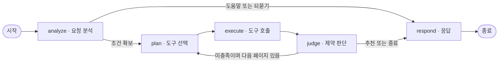

# 오픈소스 이슈 읽기 플래너 설계

플래너는 개발 취업 포트폴리오를 준비하는 사용자가 지정한 시간에 읽고 정리할 수 있는 공개 GitHub 입문 이슈를 제안한다. 계획의 범위는 이슈 본문을 읽고 메모하는 작업이다. 이슈 해결이나 병합에 필요한 시간은 추정하지 않는다.

## 실행 그래프와 상태

[메인 그래프](../backend/app/planner_agent.py)는 LangGraph의 `StateGraph`로 구성한다. 한 대화 세션에서 요청을 받을 때마다 새 실행이 시작된다.

| 단계 | 입력 | 출력과 결정 |
|---|---|---|
| analyze | 현재 발화, 직전 조건, 한국 시간 기준 오늘 날짜 | 날짜·시작·마감, 언어와 요청 종류를 추출한다. 필수 조건이 비었거나 날짜·시각이 유효하지 않으면 되묻는다. |
| plan | 의도, 조건, 현재 페이지 | 계획 요청에는 후보 목록 → 각 후보의 상세 조회 → 언어별 참고 질문 조회를 배정한다. 참고자료 요청에는 참고 질문 조회만 배정한다. 재계획에서는 다음 페이지의 목록과 상세 조회만 배정한다. |
| execute | 도구명·인자·선행 출력이 지정된 작업 목록, 실행 중 캐시 | 검색에서 받은 `owner/repo#number`를 상세 조회에 전달한다. 모든 호출의 반환값을 보관한다. 개별 도구 실패를 기록하고 독립적으로 실행할 수 있는 후속 작업을 계속한다. |
| judge | 후보별 본문 글자 수, 가용 시간, 오류, 페이지 상태 | 필요한 시간·후보별 제외 사유를 계산한다. 충족 후보가 있으면 현재 페이지에서 예상 시간이 가장 짧은 이슈를 제안한다. |
| respond | 선택한 이슈, 참고 질문, 탈락 사유, 오류 | 응답과 저장 가능한 계획, 근거 링크, 참고 글 작성자·라이선스를 반환한다. 세션에 남길 조건과 직전 응답 요약을 생성한다. |

## 제약 판단

- 사용자가 입력한 시작 시각과 마감 시각의 차이가 가용 시간이다. 같은 날 양수인 구간을 지원한다. 날짜·시각은 직접 지정하거나 ‘내일’, ‘오후 2시부터 30분 동안’처럼 지시할 수 있다.
- 본문 검토 예상 시간은 `ceil(본문 글자 수 / 300) + 5`분이다. 분당 300자와 메모 5분은 서비스의 계획 가정이다. 상세 API에서 본문 길이를 확보하지 못하면 시간을 계산하지 않고 제외한다.
- 예상 시간이 가용 시간 이내인 후보만 추천한다. 계획 종료 시각은 시작 시각에 예상 시간을 더한다. 사용자가 늦어도 시작해야 할 시각은 마감 시각에서 예상 시간을 빼서 안내한다. 예를 들어 14:00~14:10, 578자 본문이면 예상 7분으로 14:00~14:07에 읽을 수 있고 늦어도 14:03에 시작해야 한다.
- 이슈 공개 상태는 API 호출 시점에만 확인할 수 있다. 계획일과 조회일이 다르면 실제 조회일을 밝힌다. 언어별 참고 질문은 보조 자료로 제공한다.

## 재계획과 종료

현재 페이지에 제약을 충족하는 후보가 없고 다음 페이지가 있으며 상한에 도달하지 않은 경우, 같은 언어·날짜·시각을 유지하고 다음 페이지의 후보와 상세를 다시 조회한다. 이미 조회한 도구·인자가 반복되면 실행 내 캐시를 사용한다. 참고 질문은 첫 페이지만 조회한다.

`PLANNER_MAX_REPLANS`의 기본값은 2이며 허용 범위는 0~5다. 상한 2이면 첫 조회에 더해 최대 두 페이지를 추가로 확인한다. 상한 도달, 후보 소진, 후보 목록 확보 실패, 인증·쿼터·연결 등 제공기관 오류는 해당 사유를 담아 종료한다. 참고 질문만 실패하면 확보한 이슈로 계획을 완성한다.

## 의도 분류와 메모리

[의도 분석기](../backend/app/planner_intent.py)는 명확한 일정·참고자료·도움말 요청은 규칙으로 처리한다. 이 경로는 LLM을 호출하지 않는다. 자유 형식 요청의 의도가 불명확하면 서버 설정에 따라 GMS 또는 OpenAI Responses API로 시스템의 시작 도구 두 개를 제시한다. 모델이 선택한 도구, 언어와 짧은 공개용 선택 이유를 검증하여 기록한다. 후보 식별자를 받는 상세 조회는 후보 검색의 결과에 의존한다. 모델·키가 없거나 결정할 근거가 없을 때에는 사용자가 언어와 시간을 직접 입력할 수 있도록 안내한다. 모델 선택은 `PLANNER_MODEL`로 변경할 수 있으며 기본값은 `gpt-4.1`이다. 실제 모델이 커뮤니티 토론 자료 요청에 참고 질문 검색을 선택한 기록을 첨부한다. [실제 호출 결과](evidence/live-model-selection.json)

- 대화 세션별로 정규화된 조건, 직전 요청·응답 요약(최대 800자), 직전 추천 이슈 ID, 다른 이슈를 요청해 제외했던 ID(최대 40개)를 저장한다. 도구 원본 응답은 메모리에 복사하지 않는다.
- ‘마감만 15:00까지’는 마감만 갱신한다. ‘다른 이슈로’는 이전 추천 ID를 제외한다. ‘새 계획’은 직전 조건을 배제하고 새 입력으로 계획한다. 반복 호출 방지 캐시는 요청이 끝나면 폐기한다.
- 세션 메모리와 실행 기록은 SQLite의 별도 테이블에 기록한다. 메모리는 후속 요청의 조건을 유지한다. 실행 로그는 당시 발생한 사건의 순서와 내용을 재구성한다.

## 이벤트와 로깅

[EventBus와 LoggingAgent](../backend/app/planner_events.py)는 동기 발행·구독으로 연결한다. 메인 그래프는 발행 함수만 받고 로깅 Agent를 직접 참조하지 않는다. 구독자가 없거나 저장에 실패해도 메인 그래프는 응답을 완성한다. 수집·저장에 LLM을 호출하지 않는다.

| 이벤트 | 주요 데이터 |
|---|---|
| chat_started / chat_completed | 사용자 요청, 최종 상태·답변·생성 계획 |
| stage_start / stage_end | 단계 이름, 해당 단계의 상태·판단·이유 |
| decision | 분류 방식, 의도, 선택한 도구, 공개용 판단 이유, 변경된 조건 |
| plan | 페이지, 호출할 도구와 인자, 앞선 결과에서 가져올 값 |
| tool_request / tool_response | 도구 이름, 요청 인자, 성공·실패 여부, 구조화된 응답, 소요 시간(ms) |
| replan | 판단 사유, 현재·다음 페이지, 반복 횟수와 상한 |

공통 필드는 `session_id`, `run_id`, 실행 내 발생 순서 `seq`, 시각 `at`, `type`, `stage`, `data`다. 저장한 로그를 목록·세션 상세로 조회하고 세션 단위로 삭제할 수 있다. 자세한 시나리오별 실행 결과는 [재계획 실행 로그](evidence/replan-run.json)와 [시나리오 결과](evidence/scenarios.json)에 있다.
